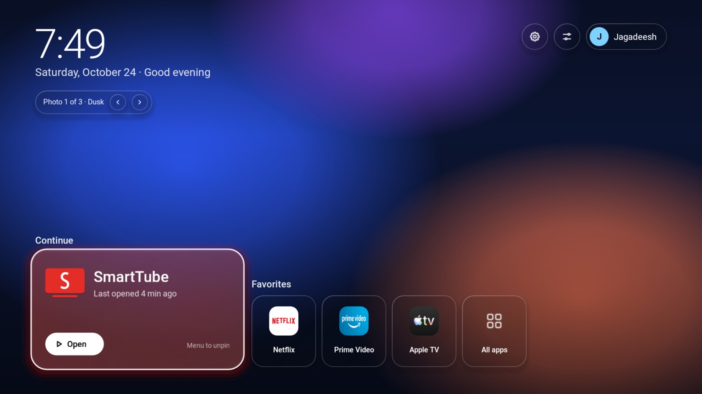
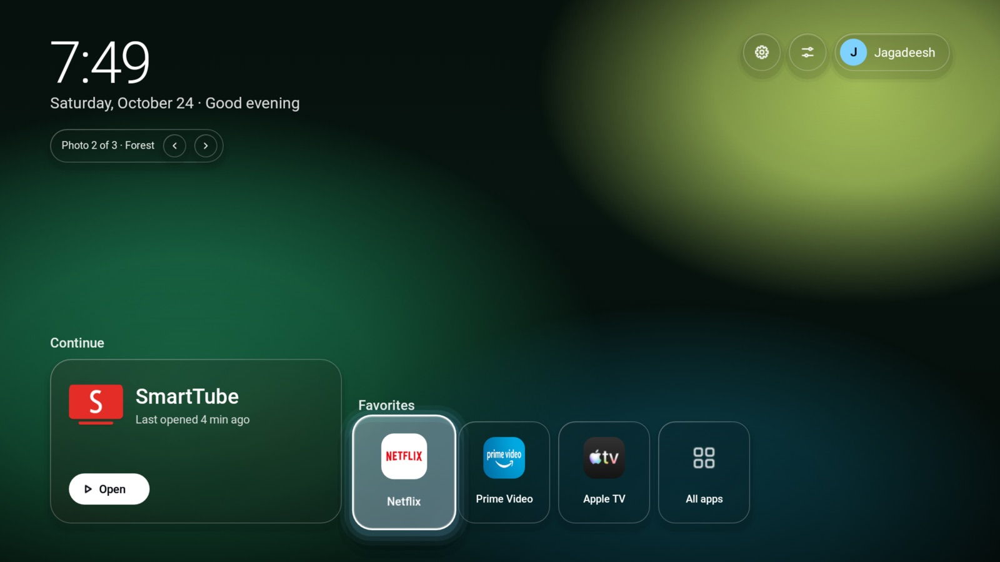
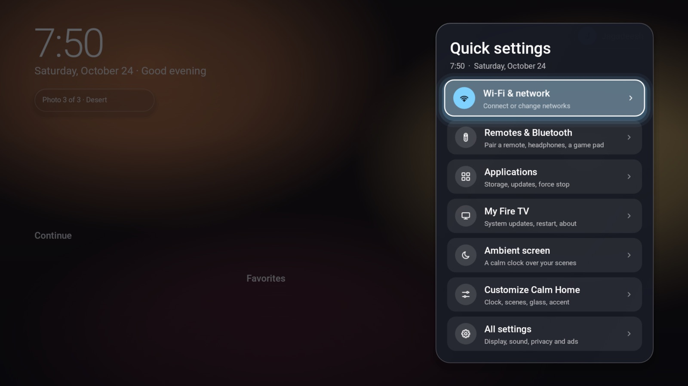
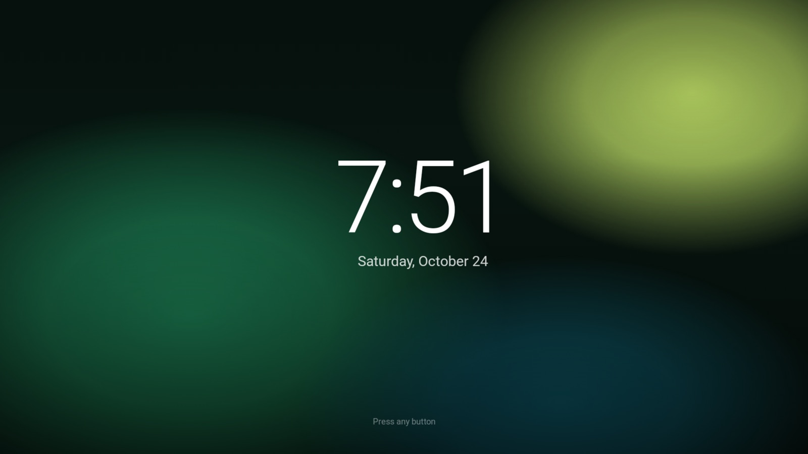
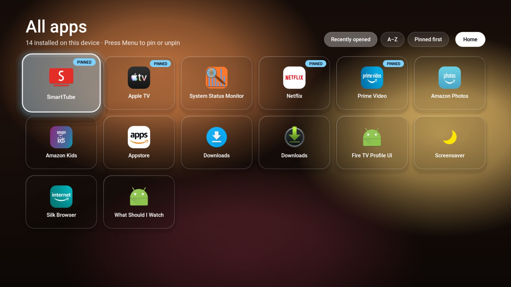
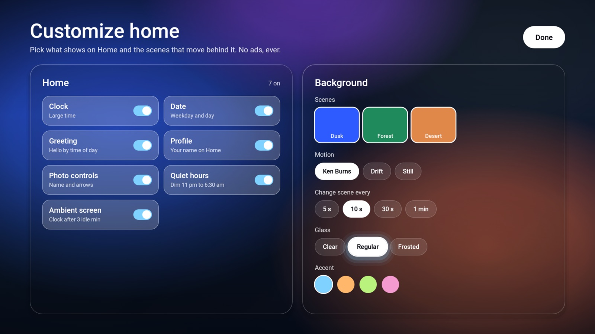

# Calm Home

A calm, ad-free home screen for **Amazon Fire TV** and **Android TV**, written from scratch, plus a
one-command installer with an app catalog and a reversible debloat.

**Website:** https://jthiruveedula.github.io/calm-home/



## Install

On the TV, turn on **ADB debugging** (Fire TV: Settings > My Fire TV > Developer options). Then, on a
computer on the same Wi-Fi with Node 18+:

```bash
npx github:jthiruveedula/calm-home install
```

It finds the TV, connects (accept the prompt on the TV), downloads the latest release, verifies its
SHA-256 and installs it. If `adb` is missing it offers to fetch Google's platform-tools.

| Command | What it does |
|---|---|
| `scan` | Find TVs with network ADB on your Wi-Fi |
| `install` | Install or update Calm Home (`--apk <file>` for a local build) |
| `status` | Device, DNS, installed apps, debloat state |
| `apps`, `add <app>` | App catalog; `add smarttube` installs the right CPU build, checksum-verified |
| `debloat` | Fire TV: disable 45 Amazon telemetry/ads/promo packages, reversible (`--dry-run`) |
| `restore` | Undo the last debloat from its backup (`--all` for the whole list) |
| `sideload <apk>`, `uninstall [app]` | Install any APK; remove Calm Home or a catalog app |

Add `--device <ip>` when more than one TV is on the network, `--yes` to skip prompts.

## What it is

It follows the "Liquid Glass" design: a clock, softly moving colour scenes, glass tiles, your
favourite apps and an All apps screen. On Fire TV it is a normal app you open from Your Apps (Fire
OS does not let any app replace Amazon's Home button); on Android TV it can be the launcher.

- **No permissions at all.** No network, no storage, no accounts. About 80 KB.
- **Reversible.** Uninstall it and nothing else on the TV has changed.
- **Pure Android, no libraries, no Gradle.** `aapt2 -> javac -> d8 -> zipalign -> apksigner`.

| Home | Quick settings | Ambient |
|---|---|---|
|  |  |  |
| **All apps** | **Customize** | |
|  |  | |

## Screens

| Screen | What it does |
|---|---|
| Home | Clock, date and greeting, scene control. **Continue**: a large card for the favourite you opened last, washed in that app's colour, with when you last opened it. Favorites row, All apps, Quick settings and Customize buttons |
| Quick settings | Gear button. Glass side panel: Wi-Fi & network, Remotes & Bluetooth, Applications, My Fire TV (updates, restart), Ambient screen, Customize, All settings |
| Ambient screen | After 3 idle minutes on Home (or from Quick settings): a large, slowly drifting clock over the scenes. The first button press only wakes it |
| All apps | Every installed app. Sort by Recently opened, A-Z or Pinned first. Press Menu on an app to pin or unpin it |
| Customize | Toggle Clock, Date, Greeting, Profile, Photo controls, Quiet hours, Ambient screen. Pick scenes, motion, change interval, glass level and accent colour |

Motion: focus moves on a damped spring with a soft accent glow, the background drifts a little
toward what you focus (parallax), screens enter with a short stagger, and Select gives a small press dip.
Measured on a 2018 Fire TV Stick 4K: about 1% janky frames while navigating.

Fire OS lets a third-party app open only some settings screens (Network, Applications, My Fire TV,
Remotes & Bluetooth). Display, sound, privacy and ads need Amazon's own permission, so they are
reached through All settings.

Remote: D-pad moves, Select opens, **Menu (the three-lines button)** or **holding Select** pins and
unpins, Back goes to Home (and from Home leaves the app).

## Build and test

```bash
./test.sh              # 1,867 desktop checks on the pure-Java core
./tools/mutate.sh      # plants 32 bugs one at a time; every one must be caught
./build.sh             # runs the tests, then builds build/CalmHome.apk
npm test               # CLI unit tests
```

Needs JDK 17 and the Android SDK (`platforms;android-34`, `build-tools;34.0.0`):
`brew install openjdk@17 android-commandlinetools android-platform-tools`.
The signing key is created at `~/.android/calmhome.keystore`. Keep it: updates must use the same key.

Emulator checks (Android 7.1 phone image and Android 12 TV image): `tools/emu-shot.sh <name> [KEYCODE ...]`
sends keys and saves a screenshot to `build/shots/`.

Real-device audit: `SERIAL=<stick-ip>:5555 ./tools/stick-audit.sh` presses every button on the stick
and checks what really opened (foreground activity, or Calm Home's own log for in-app actions).

Logo: `python3 tools/make-logo.py` draws the banner and icon PNGs (Fire OS cannot show vector banners).

## Install manually with adb

1. Fire Stick: Settings > My Fire TV > Developer options > ADB debugging ON.
2. `adb connect <stick-ip>:5555`, accept the prompt on the TV.
3. `adb install -r build/CalmHome.apk`, then open **Calm Home** from the apps list.

Remove it: `adb uninstall com.jay.calmhome`.

## How it is organised

| File | Role |
|---|---|
| `Scenes`, `SpatialNav`, `LaunchLog`, `Options`, `AppOrder`, `Ambient`, `AppEntry`, `Motion`, `HomeLayout` | Pure Java logic, fully tested without a device |
| `CalmView` | The whole UI on one Canvas, in the design's 1920x1080 units |
| `Gfx`, `Background` | Glass drawing helpers; pre-rendered scene bitmaps |
| `AppRepo`, `TileArt`, `Settings`, `MainActivity` | App discovery and icons, saved choices, the host |

## Left out on purpose

The design's Weather, Calendar, Now playing and Bluetooth Photo Drop need network, calendar or
Bluetooth permissions. Calm Home stays permission-free; they can be added later as opt-in features.
